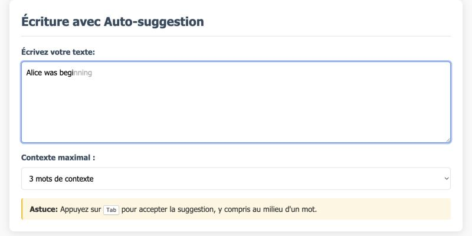
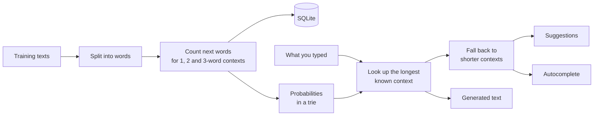

<div align="center">

# Text prediction with n-grams

Predicting the next word from the last few words you typed, using nothing but word counts.

[Results](#results) · [How it works](#how-it-works) · [Run it](#run-it) · [API](#api)



<sub>Autocomplete in the middle of a word: press Tab to accept the grey text.</sub>

</div>

## About

This app learns from plain text which words tend to follow which, then uses those statistics to help you write. It's written in Scala 3 for a functional programming course, and it offers:

- **Autocomplete** while typing, including in the middle of a word, using the Tab key
- **Suggestions** of the most likely next words, with their probabilities
- **Text generation** from a prefix
- **Custom models** trained on your own `.txt` files and kept across restarts

It comes with an English and a French model, trained on public domain books.

## Results

Each model is trained on 90% of its corpus. On the remaining 10%, this measures how often the real next word is among the 3 suggestions:

| Maximum context | English, exact only | English, with fallback | French, exact only | French, with fallback |
| --- | :---: | :---: | :---: | :---: |
| 1 word | 19.4% | 19.4% | 16.0% | 16.0% |
| 2 words | 9.7% | 19.9% | 8.7% | 16.9% |
| **3 words** | 2.8% | **20.1%** | 2.1% | **16.9%** |

Without the fallback, a 3-word context is recognised only about 15% of the time in English; with it, a suggestion exists about 94% of the time. The precision gained from a long context stays small because the corpora are small (about 108,000 words in English and 173,000 in French), so adding more text is probably the best way to improve results.

Reproduce the table with:

```bash
sbt "runMain evaluerModeles"
```

The model reproduces the style of its training texts without understanding them. A generated sample, starting from "the queen said":

> the queen said get to your places shouted the queen can you play croquet the frog-footman repeated in the same tone exactly as if nothing had happened how am i to get in

## How it works

**To guess the next word, look at what followed the same words in the training texts.** If "the cat" was followed twice by "sleeps" and once by "eats", then "sleeps" has a probability of 2/3 and "eats" 1/3.

The model doesn't understand what words mean; it only remembers frequencies. That's also why generated text can look like a correct sentence without necessarily meaning anything.

How many words to look at is a trade-off. A long context gives more precise predictions but is less likely to have been seen before. A short context is almost always known but is less precise. The fallback in step 4 gets the benefit of both.



**1. Split the text into words.** The text is lowercased and only words are kept, with their accents and any apostrophes and hyphens inside them. Predictions use the same code ([Tokeniseur.scala](src/main/scala/models/Tokeniseur.scala)), so a learned word is always found again in the same form.

**2. Count.** A window slides over the text and, for each context of 1, 2 and 3 words, counts the word that comes next. With the text `the cat sleeps a cat eats`:

| Context | Next words |
| --- | --- |
| `the` | cat: 1 |
| `cat` | sleeps: 1, eats: 1 |
| `the cat` | sleeps: 1 |
| `a cat` | eats: 1 |

These **counts** are what gets saved, not the probabilities. Two counts can be added together, but two probabilities can't, which is what makes it possible to enrich a model with new texts.

**3. Store in a trie.** The probabilities calculated from the counts go into a prefix tree where each edge holds one character. The context `the cat` is found by walking down `t`, `h`, `e`, ` `, `c`, `a`, `t`, in a time that depends on the length of the context and not on the number of entries. A second trie holds the vocabulary: walking down `q`, `u`, `e` reaches every word starting with "que", which is used to finish a word being typed.

**4. Fall back to a shorter context.** Words from the longest context come first. A word that isn't there is looked up in the shorter context, with its score multiplied by 0.4 for each context word removed. This method is called *stupid backoff* (Brants et al., 2007). The scores are then scaled so they add up to 1.

With the text above, for the phrase `the cat`:

| Word | Found in | Calculation | Score | Displayed probability |
| --- | --- | :---: | :---: | :---: |
| sleeps | `the cat` | 1 | 1.0 | 83% |
| eats | `cat` only | 0.5 × 0.4 | 0.2 | 17% |

**5. Use the result**, in three ways:

- **Suggestions:** the words with the best scores.
- **Autocomplete:** if the text ends in the middle of a word, only candidates starting with those letters are kept, then the vocabulary fills out the list. After `the que`, the context `the` and the start `que` give `queen`.
- **Generation:** a word is drawn at random from the full distribution of the longest known context and added to the text, then the process repeats. The random draw makes each text different, whereas always taking the most likely word would quickly go round in circles.

### Limitations

- A sequence of words never seen before can't be predicted from its meaning, only from its last words.
- Punctuation is ignored, so n-grams can span two sentences.
- Generated words are lowercase.

## Run it

You need a JDK (tested with Java 25) and [sbt](https://www.scala-sbt.org/).

```bash
sbt run
```

Then open <http://localhost:8080/>. On the very first run, the app trains two models from `training-texts/`: `default` (English) and `francais` (French). This takes a few seconds; later runs reload them from `models/modeles.db`.

To build and run a standalone JAR:

```bash
sbt assembly
```

```bash
java -jar target/scala-3.3.9/predictive-text-app.jar
```

| Environment variable | Default | Purpose |
| --- | --- | --- |
| `HOST` | `localhost` | Address to listen on |
| `PORT` | `8080` | Port to listen on |
| `MODELS_DIR` | `models` | Folder for the SQLite database |
| `TRAINING_TEXTS_DIR` | `training-texts` | Texts learned on the first run |

The API has no authentication, so keep `HOST=localhost` unless the app sits behind a service that controls access.

The tests cover the algorithm, storage, the API routes and prediction quality on the real corpora:

```bash
sbt test
```

## API

| Request | Parameters | Result |
| --- | --- | --- |
| `GET /api/suggestions` | `texte`, `taille` (1-3, default 3), `nombre` (1-50, default 5), `modelId` | Most likely next words |
| `GET /api/completion` | `texte`, `taille`, `nombre` (default 3), `modelId` | The `prefixe` already typed and the proposed words |
| `GET /api/generer` | `prefixe`, `tailleNGramme` (1-3), `nombreMots` (1-1000, default 50), `modelId` | Generated text |
| `GET /api/models` | | List of models |
| `POST /api/upload` | `modelId`, `append` (default `false`), multipart `.txt` files, 64 MB at most | Creates or enriches a model |
| `DELETE /api/models/{id}` | | Deletes a model, except `default` |

Errors are returned as JSON, in the form `{"error": "..."}`, with the matching status: 400 for an invalid request, 403 for another origin, 404 for an unknown model, 409 if the model to create already exists, and 413 for an upload that is too large.

## Author

Daniil Hirchyts

## Data

The training texts in [`training-texts/`](training-texts) are public domain books, most of them distributed by [Project Gutenberg](https://www.gutenberg.org/):

- **English:** *Alice's Adventures in Wonderland* (Lewis Carroll), *The Belle of a Season* (Countess of Blessington), *The Problem Club* (Barry Pain), *The Old Worcester Jug* (Eglanton Thorne), *An Historical Sketch of the First Hillsboro Baptist Church* (Wellington Camp)
- **French:** *Hier et demain : pensées brèves* (Gustave Le Bon), *De Pontoise à Stamboul* and *Les mariages de Paris* (Edmond About)

## License

MIT
